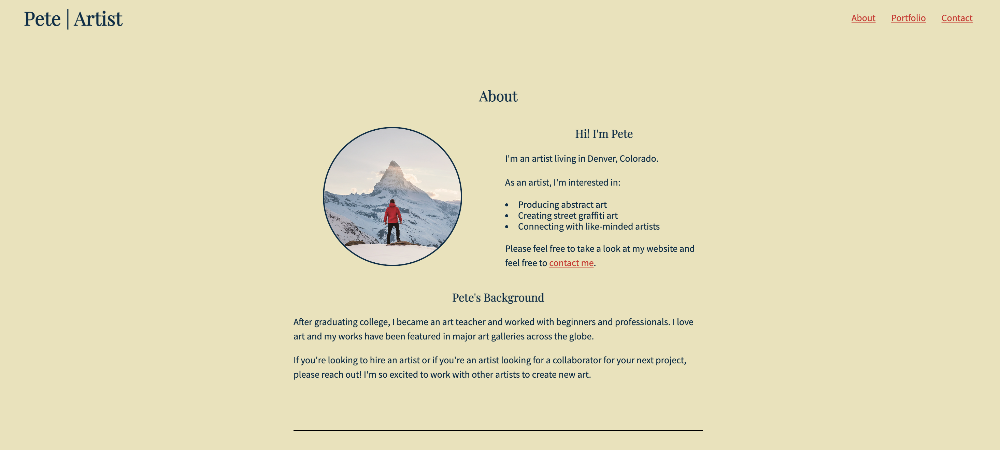
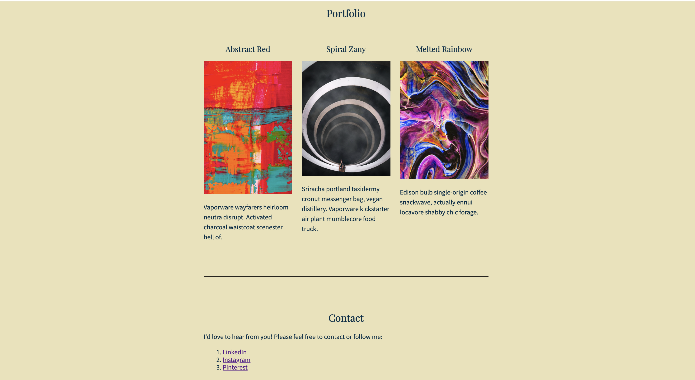
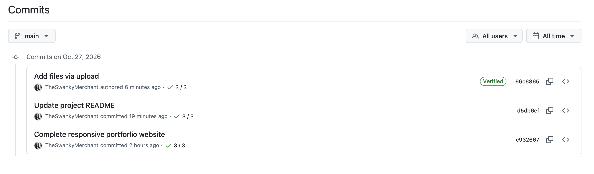

# Pete's Portfolio Starter Project

This repository contains a starter template for Pete's portfolio. The project helps you learn how to create a personal portfolio page using HTML and CSS, while also getting familiar with basic design principles.

## Project Overview

Pete' Portfolio is a responsive artist portfolio website built using HTML and CSS. The website include About, Portfolio, and Contact sections. The project demostrates the use of CSS Flexbox, typography, spacing, image styling, and layout techniques to create a clean, organized, and visually applealing website.

## Features

- **About Section:** Displays Pete's profile image, introduction, artistic interests, and professional background.
- **Portfolio Section:** Showcases three artwork images with titles and descriptions in a three-column layout.
- **Contact Section:** Provides links to LinkedIn, Instagram, and Pinterest.
- **CSS Styling:** Uses Flexbox, custom fonts, colors, spacing, and image styling to create a visually organized website.
- **Centered Layout:** Uses CSS width and max-width properties to keep the main content centered on the webpage.

## Technologies Used

- **HTML5:** Structures the website's content, including headings, paragraphs, images, links, and sections.
- **CSS3:** Controls colors, typography, spacing, and overall visual presentation.
- **CSS Flexbox:** Arranges the About and Portfolio sections into horizontal layouts.
- **CSS Media Queries:** Adjusts the About section layout for smaller screens.
- **Visual Studio Code:** Code editor used to develop and modify the website.
- **Live Server:** Provides real-time browser previews during development.
- **Git:** Tracks changes and maintains version history.
- **GitHub:** Hosts the project repository and source code.
- **GitHub Pages:** Publishes the completed website online.

## Live Website

View the completed portfolio website:

https://theswankymerchant.github.io/pete-portfolio/

## GitHub Repository

View the project source code:

https://github.com/TheSwankyMerchant/pete-portfolio

## Screenshots

## Design and Implementation Plan

### Original Layout

The original portfolio used a basic HTML and CSS structure with About, Portfolio, and Contact sections. The initial layout required improvements to spacing, alignment, and content organization.

### Revised Layout

I redesigned the layout using CSS Flexbox to position the About image and text side by side and organize the three portfolio projects horizontally. I also adjusted margins, padding, typography, and content widths to improve the overall presentation.

## Implementation Plan

My approach was to review the existing HTML structure, identify the CSS changes needed, implement the layout improvements, test the results in the browser, and make adjustments until the website matched the project requirements.

### Design Trade-offs

I chose Flexbox because it simplified horizontal alignment and spacing without requiring major changes to the HTML structure. I also used a maximum content width to keep the website centered and readable.

## AI Tools and Learning Reflection

### AI Tool Disclosure

I used ChatGPT as a learning and debugging assistant throughout this project. It helped me understand CSS concepts, troubleshoot layout issues, interpret project requirements, and navigate GitHub.

I used AI to support my learning while actively working through the implementation and testing the website myself.

### Key Decisions and Challenges

CSS Flexbox: I used Flexbox to arrange the About section and portfolio artwork horizontally. I learned how properties such as display: flex, gap, and flex-wrap affect the layout.

Spacing and Alignment: I adjusted margins, padding, and maximum widths to center the content and improve readability.

Debugging: I encountered challenges with CSS alignment, Git commands, GitHub publishing, and README image paths. I resolved these issues by reviewing the code, identifying the causes, making corrections, and verifying the results.

GitHub and Documentation: I learned how to commit changes, publish a website using GitHub Pages, and document my development process using Markdown.

### Key Learning Moments

This project helped me better understand how HTML structure and CSS styling work together. I also gained practical experience using browser previews, troubleshooting errors, and managing project files through GitHub.
